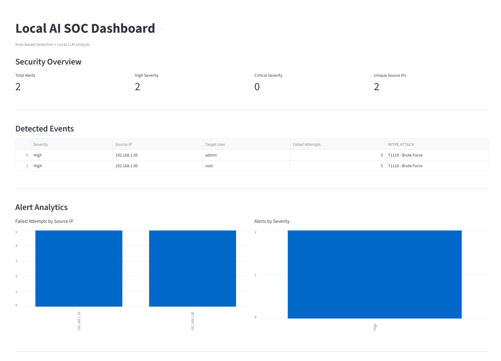
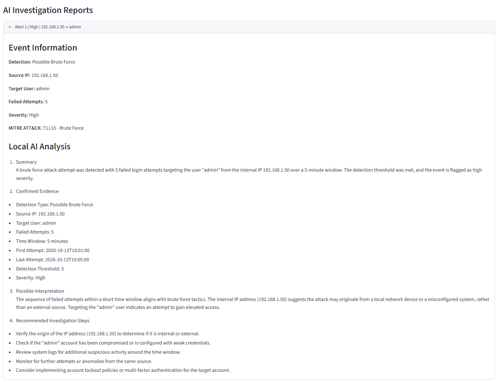
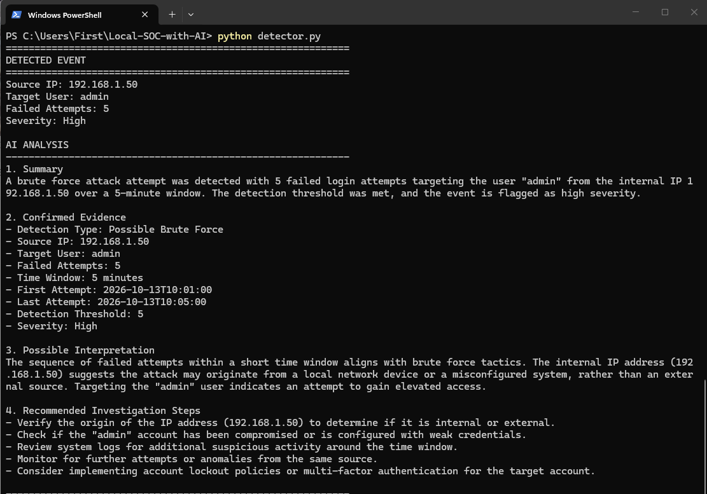

# Local AI SOC Analyzer


A local cybersecurity monitoring project that combines rule-based brute-force detection with a locally hosted Large Language Model for SOC-style investigation summaries.

The project is designed to keep security log analysis local while separating deterministic detection logic from AI-assisted interpretation.

---

## Overview

The Local AI SOC Analyzer parses authentication logs, detects suspicious failed-login patterns, maps detections to MITRE ATT&CK, and sends only confirmed event metadata to a locally hosted Qwen model through Ollama.

The detection engine makes the security decision.

The AI layer does not decide whether an event is malicious. It assists with explanation, context, and recommended investigation steps.

---

## Architecture

```text
Authentication Logs
        |
        v
Parser Layer
        |
        v
Detection Engine
        |
        v
Sliding Window Analysis
        |
        v
Confirmed Security Event
        |
        +----------------------+
        |                      |
        v                      v
MITRE ATT&CK Mapping      Local Ollama API
                               |
                               v
                           Qwen 8B
                               |
                               v
                         SOC AI Summary
        |
        v
soc_report.json
        |
        v
Streamlit Dashboard

Additional Components:
- pytest automated tests
- GitHub Actions CI
- Application logging
- CLI configuration
```

--- 

## Screenshots

### SOC Dashboard


### AI Analysis


### PowerShell


## Features
- Parses Linux SSH auth.log style events
- Supports a simplified simulated authentication log format
- Detects brute-force login attempts using a sliding time window
- Supports multiple source IP addresses
- Supports multiple target users
- Uses configurable detection thresholds
- Uses configurable time windows
- Maps detections to MITRE ATT&CK
- Uses Qwen locally through Ollama
- Keeps AI analysis separate from detection logic
- Prevents the LLM from changing detector severity
- Exports structured JSON reports
- Includes a Streamlit dashboard
- Includes operational application logging
- Includes graceful fallback when Ollama is unavailable
- Includes automated unit tests
- Uses GitHub Actions for continuous integration
- Keeps AI inference local for privacy-focused analysis
Detection Logic
The default brute-force rule triggers when:
- The same source IP
- Targets the same user
- Generates at least 5 failed login attempts
- Within a 5-minute time window

## Detection Logic
The default brute-force rule triggers when:
- The same source IP
- Targets the same user
- Generates at least 5 failed login attempts
- Within a 5-minute time window

### Example
 
```text
192.168.1.50 -> admin
5 failed login attempts
within 5 minutes
-> Possible Brute Force
```
The detection engine uses a sliding time window rather than simply counting all failed attempts in the entire log file.

---

## MITRE ATT&CK Mapping
Current brute-force detections are mapped to:
- T1110 - Brute Force
- T1110.001 - Password Guessing
Future versions may include additional authentication attack techniques such as password spraying.

---

## Supported Log Formats
### Linux SSH Authentication Log
Example:
```text
Oct 14 12:31:07 ubuntu sshd[1234]: Failed password for root from 
192.168.1.50 port 55231 ssh2
```
### Simple Test Format
Example:
```text
2026-10-14 13:01 Failed password for admin from 192.168.1.80
```
Unsupported lines are ignored and counted during parsing.

---

## Example Detection
```text
============================================================
DETECTED EVENT #1
============================================================

Source IP: 192.168.1.50
Target User: root
Failed Attempts: 5
Window: 5 minutes
Severity: High
Log Source: linux_auth
MITRE ATT&CK: T1110 - Brute Force
MITRE Sub-technique: T1110.001 - Password Guessing
```

The confirmed metadata is then passed to the local LLM for investigation assistance.

---

## AI Analysis Design
The AI layer is intentionally restricted.
The model is instructed to:
- Use only confirmed facts
- Avoid inventing indicators of compromise
- Avoid inventing IP addresses, usernames, hosts, ports, or timestamps
- Avoid claiming compromise unless evidence proves it
- Avoid claiming malicious intent as confirmed
- Never change severity assigned by the detection engine
- Separate confirmed evidence from possible interpretation
- Recommend additional investigation steps

This architecture reduces the risk of AI hallucination affecting the actual detection decision.

---

## AI Failure Handling
The detection engine does not depend on the LLM.
If Ollama is unavailable, the program still completes rule-based detection successfully.
Example fallback:
```text
AI analysis unavailable.

Could not connect to the local Ollama service.

The rule-based detector completed successfully.
```
This prevents the AI layer from becoming a single point of failure.

--- 

## Technology Stack
- Python
- Ollama
- Qwen 8B
- Streamlit
- Pandas
- Pytest
- GitHub Actions
- JSON
- Regular Expressions
- MITRE ATT&CK
- Python Logging
- argparse

---

## Project Structure
``` text
local-ai-soc-analyzer/
|
|-- detector.py
|-- detection_engine.py
|-- dashboard.py
|-- config.json
|-- requirements.txt
|-- README.md
|-- .gitignore
|
|-- sample_auth.log
|-- sample_security_log.log
|-- mixed_test.log
|
|-- tests/
|   `-- test_detection_engine.py
|
|-- screenshots/
|   |-- dashboard.png
|   |-- dashboard-analysis.png
|   `-- powershell.png
|
`-- .github/
    `-- workflows/
        `-- tests.yml
```
Generated files are excluded from version control:
``` text
soc_report.json
logs/
.pytest_cache/
__pycache__/
```
---

## Installation
### 1. Clone the Repository
```
git clone https://github.com/mattitute/local-ai-soc-analyzer.git
cd local-ai-soc-analyzer
```

### 2. Install Python Dependencies
```
pip install -r requirements.txt
```

### 3. Install Ollama
Install Ollama on the local machine.
Then pull the model:
```
ollama pull qwen3:8b
```

---

## Configuration
Default settings are stored in:
```
config.json
```

Example:
```
{
    "threshold": 5,
    "window_minutes": 5,
    "ollama_model": "qwen3:8b",
    "ollama_url": "http://localhost:11434/api/generate"
}
```

---

## CLI Usage
Run the analyzer using default configuration:
```
python detector.py --log sample_auth.log
```

Use a custom threshold:
```
python detector.py --log sample_auth.log --threshold 10
```

Use a custom detection window:
```
python detector.py --log sample_auth.log --window 3
```

Override both:
```
python detector.py --log mixed_test.log --threshold 5 --window 3
```

Display help:

```
python detector.py --help
```

---

## JSON Reporting
Detected events are exported to:

```
soc_report.json

```

Example:
```
[
    {
        "detection_type": "Possible Brute Force",
        "source_ip": "192.168.1.50",
        "target_user": "root",
        "failed_attempts": 5,
        "window_minutes": 5,
        "detection_threshold": 5,
        "severity": "High",
        "mitre_technique": "T1110 - Brute Force",
        "mitre_subtechnique": "T1110.001 - Password Guessing",
        "log_source": "linux_auth",
        "ai_status": "success"
    }
]
```

---

## Dashboard
Run the detector first:
```
python detector.py --log mixed_test.log
```

Then launch the dashboard:
```
streamlit run dashboard.py
```

The dashboard displays:
- Total alerts
- High-severity alerts
- Critical alerts
- Unique source IP addresses
- Failed attempts by source IP
- Severity distribution
- MITRE ATT&CK mapping
- Expandable AI investigation reports

---

## Automated Testing
The detection engine includes automated tests for:
- Attempts below the threshold
- Threshold-triggered detection
- Attempts outside the detection window
- Multiple source IP addresses
- Separate target users
Run tests with:

```
python -m pytest -v
```

Example:
```
test_four_attempts_no_alert PASSED
test_five_attempts_trigger_alert PASSED
test_attempts_outside_window_no_alert PASSED
test_multiple_ips PASSED
test_different_users_are_separate PASSED

5 passed
```

## Continuous Integration
GitHub Actions automatically runs the test suite when:
- Code is pushed to main
- A pull request targets main
Workflow file:
```
.github/workflows/tests.yml
```

A failing unit test causes the CI workflow to fail.
This helps ensure detection logic remains stable as the project evolves.

---
 
## Application Logging
Operational activity is written locally to:
```
logs/app.log
```

Example entries:
```
2026-10-14 13:30:11 | INFO | Local AI SOC Analyzer started
2026-10-14 13:30:11 | INFO | Input log file: mixed_test.log
2026-10-14 13:30:11 | INFO | Log parsing complete: 10 events parsed, 1 lines ignored
2026-10-14 13:30:11 | INFO | Detection complete: 2 alerts generated
2026-10-14 13:30:42 | INFO | AI analysis completed for 192.168.1.50 -> root
2026-10-14 13:31:05 | INFO | SOC report saved to soc_report.json
```

Application logs are excluded from Git version control.

---

## Privacy
AI inference runs locally through Ollama.
Security event metadata does not need to be sent to an external cloud-based AI service.
This architecture allows experimentation with privacy-conscious AI-assisted security workflows.

---

## Design Philosophy
The project follows a simple principle:
```
Detection should be deterministic.
AI should assist investigation.
```

The rule-based engine identifies suspicious behavior using explicit thresholds and timing rules.
The AI model is used only after detection to help explain the event and suggest investigation steps.

---

## Limitations
This project is currently an educational and portfolio prototype.
Current limitations include:
- Limited supported log formats
- Linux syslog timestamps do not include the year
- Detection currently focuses mainly on failed authentication events
- Severity scoring is intentionally simple
- Detection rules are not yet dynamically loaded
- No external threat-intelligence enrichment
- AI output still requires human analyst review
- The project is not a replacement for a SIEM, EDR, or production SOC platform

---

## Future Improvements
Planned improvements include:
- Windows Event ID 4625 support
- Password spraying detection
- Additional MITRE ATT&CK techniques
- Threat-intelligence enrichment
- IP reputation lookup
- More log parsers
- Detection rule configuration profiles
- Additional automated tests
- Docker support
- Improved Streamlit filtering
- Historical alert analysis
- Alert search and filtering
- CSV export
- Additional visualization
- Real-time log monitoring
- Authentication success correlation
- Successful-login-after-failures detection

---

## Learning Goals
This project demonstrates practical experience with:
- Python security tooling
- Authentication log parsing
- Detection engineering
- Sliding-window event correlation
- MITRE ATT&CK
- Local LLM deployment
- Ollama API integration
- AI guardrails
- JSON reporting
- Streamlit dashboards
- Unit testing
- CI/CD fundamentals
- Git and GitHub
- Operational logging
- Privacy-focused AI architecture

--- 

## Disclaimer
This project is intended for educational and portfolio purposes.
The included logs are simulated sample data.
Do not use this tool as a replacement for professional security monitoring, incident response, SIEM, EDR, or other production security systems.